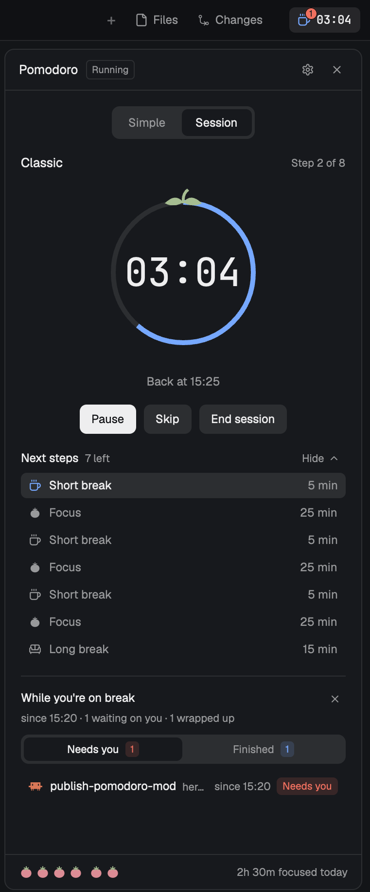
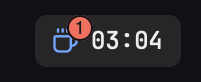
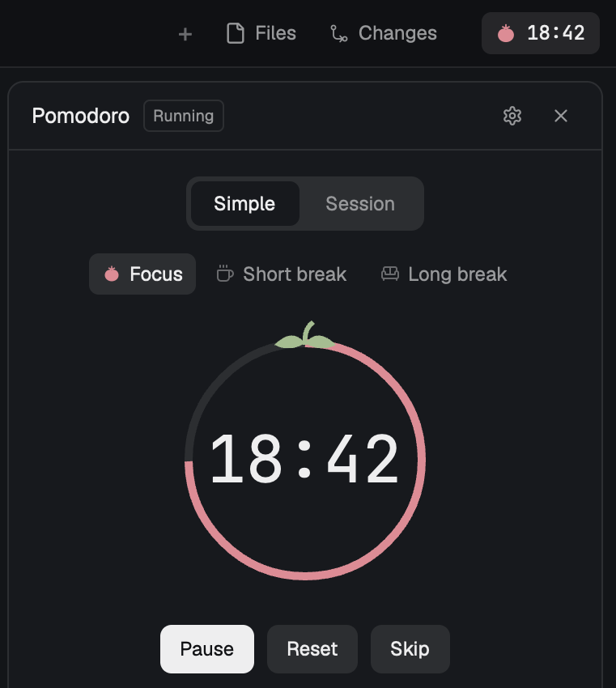
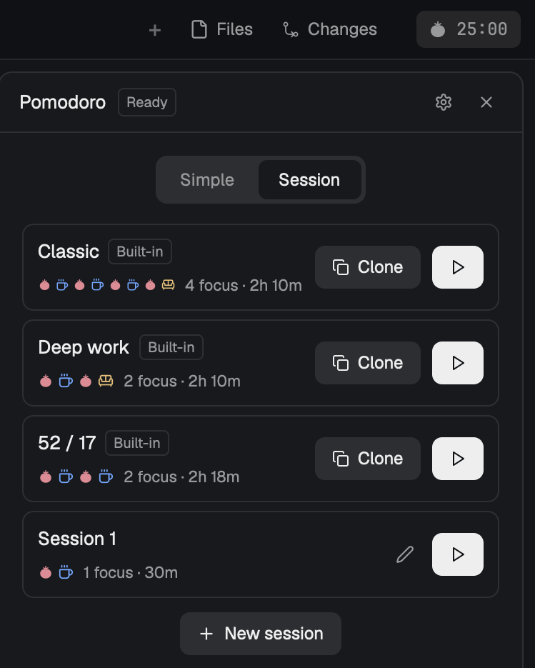
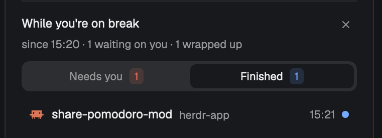
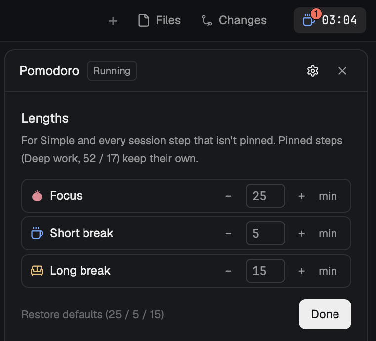

# Pomodoro for Herdr

A pomodoro timer that lives in the [Herdr](https://herdr.dev) window, and keeps an eye on your
coding agents while you're on a break. When you come back, it tells you which agents are waiting
on you and which ones finished while you were away.



## What you get

### A timer in the corner of the tab bar



The chip shows the current phase and the time left, all the time, even with the panel closed.
Click it to open the panel. On a break, a red badge counts the agents waiting on you, so you know
before you open anything.

### A tomato that drains as you work



**Simple** is the classic loop: Focus, then a short break, and a long break after every 4th focus.
The ring empties clockwise from the stem as time runs out, in tomato red for focus and in the break
color on a break. Each phase waits for Start, and − / + set its length before it begins.

### Sessions that run themselves



**Session** runs a planned list of focus and break steps, each one starting the moment the last
ends. Three come built in: Classic (4 × 25 / 5, long break at the end), Deep work (50 / 10 / 50 / 20)
and 52 / 17. Clone one to change it, or build your own: reorder steps, give a step its own length,
or lock a session's times so changing your defaults doesn't touch it.

While a session runs, **Next steps** lists what's left. Finished steps drop off, and **Hide**
folds the list away if you'd rather just see the clock.

### What your agents did while you were away



From the moment a break starts, Pomodoro watches every agent Herdr knows about (Claude Code,
Codex, pi, and anything else that reports its status):

- **Needs you** lists the agents blocked on a question right now, newest first, with the time
  they started waiting.
- **Finished** lists the agents that were working and finished during your break, with the time.
  The dot stays filled until you've looked at that agent.

Click a row to jump to that agent's pane. The summary stays until you dismiss it or your next
break starts a fresh one.

### Today, in tomatoes

The footer shows one tomato per focus you finished today, in groups of four, and how long you've
focused. Both reset at midnight.

### Your own lengths



The gear sets Focus, Short break and Long break (1 to 180 minutes; 25 / 5 / 15 by default).
Simple and every session step that doesn't have its own length follow them.

## Install

**Ask your agent.** In Herdr, tell the agent:

> Add the Pomodoro mod from https://github.com/OWNER/herdr-pomodoro

Herdr's agent reads `RECIPE.md` and the files, copies the mod into your home, and checks it.

**Or by hand:**

1. Copy the mod into Herdr:
   ```sh
   git clone https://github.com/OWNER/herdr-pomodoro
   cp -R herdr-pomodoro/mods/pomodoro ~/.config/herdr-app/mods/
   herdr-app check ~/.config/herdr-app/mods/pomodoro
   ```
2. Put the chip and the panel in a layout. Herdr's own layouts are read-only, so clone one first:
   `herdr-app do layout.clone '{"name":"main","as":"my-main"}'`. In `layouts/my-main.json`,
   replace the `tabs` block with this row:
   ```json
   { "id": "tabbar", "type": "row", "size": { "px": 42 }, "resizable": false, "children": [
     { "id": "tabs", "type": "block", "content": { "mod": "tabs" }, "window_drag": true, "size": { "weight": 1 } },
     { "id": "pomodoro-chip", "type": "block", "size": { "px": 92 }, "window_drag": true,
       "content": { "mod": "pomodoro", "props": { "compact": true } } } ] }
   ```
   and add the panel to the `panel-body` stack, after `files` and `changes`:
   ```json
   { "id": "pomodoro", "type": "block", "content": { "mod": "pomodoro", "props": { "panel": true } } }
   ```

Without a layout change, `mod.open:pomodoro` opens the same timer in a floating window.

## Keyboard shortcuts

None are bound by default. Add the ones you want to the `global` section of
`~/.config/herdr-app/keys.json`, for example:

```json
"cmd-alt-p": "mod.open:pomodoro",
"cmd-alt-space": "pomodoro.toggle",
"cmd-alt-s": "pomodoro.skip"
```

Available: `pomodoro.toggle` (start / pause), `pomodoro.reset`, `pomodoro.skip`, `pomodoro.stop`
(end a session), `pomodoro.more` and `pomodoro.less` (length of a phase that hasn't started).

## What it touches

- No network and no programs. It reads agent status through Herdr's mod API and never reads your
  terminals.
- Its state (timer, sessions, today's count, the break summary) lives in Herdr's shared values,
  so the timer keeps running with the panel closed and survives restarts.
- Sounds and toasts use Herdr's own.

## Known limits

- The panel's buttons can't be reached with Tab yet; the shortcuts above cover the timer itself.
- In Simple, the break summary stays open until you start the next focus, so it also collects
  agents that finish after the break ends but before you press Start.

## Develop

`scripts/dev.sh` copies `mods/pomodoro` into Herdr and recopies it on every save, so Herdr
hot-reloads it while you use it. `RECIPE.md` is the full brief: every size, color and behavior,
enough to rebuild the mod from scratch.
