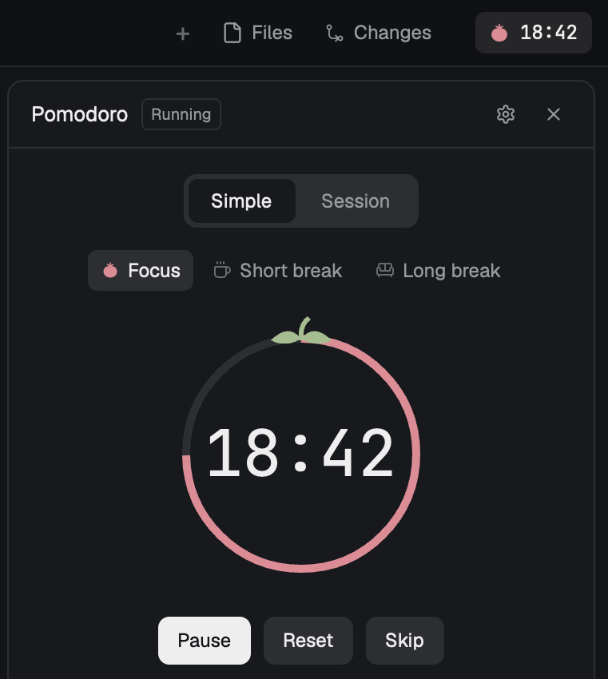

# Pomodoro

A pomodoro timer that lives in Herdr's window. A small chip in the top-right corner of the tab bar
shows the current phase's icon and the time left, ticking while you work; clicking it opens a side
panel next to Files and Changes. The panel has two interfaces: **Simple** (focus, short break, long
break after every 4th focus) and **Session** (a planned run of focus and break steps that start one
after another by themselves). Lengths are set once in Settings and followed everywhere unless a
step or a session says otherwise. Today's finished focus blocks and focused time sit in the footer.



## What you see

- **Corner chip** (layout block 92px wide, tab bar height 42px, `chrome` background, 1px `border`
  bottom line so it continues the tab bar). Inside, right-aligned: a 26px-high pill (8px side
  padding, 6px radius, 12px text) with a 14px phase icon and the time left as `mm:ss` in the
  terminal font. While running, the icon is the phase color and the text `foreground`; paused or
  not started, both are `muted`. When the panel shows Pomodoro, the pill has the `selected` background.
  On a break, a 13px round `blocked` badge with the number of agents waiting on you (9px bold,
  `background` text, 1px `chrome` ring) sits on the icon's top-right corner, 6px up and 7px out.
- **Side panel card** (fills the layout's side panel, 10px radius, 1px `border`, `background` fill):
  - Header, 42px: "Pomodoro" (13px semibold), a small badge **Ready / Running / Paused**
    (10px, bordered), then a gear button (Settings) and × (hides the panel).
  - Body, 16px padding, scrolls: a segmented switch **Simple | Session** (`raised` track, the
    chosen side on `background`), then the chosen view.
  - Footer, 36px, top border, 11px `muted` text. On the left, the day strip: a 15px two-tone tomato
    (`tomato.svg` body in `ansi1` under `calyx.svg` in `ansi2`, 2px apart) per focus finished today, in groups of 4 with a 6px gap (where a long break
    falls), at most 12 and then `+N`; `No focus finished yet` when there are none. On the right,
    `1h 05m focused today`.
- **Tomato ring clock** (Simple and running-session views): a 176px ring (5px stroke, radius 72).
  The track is `raised`. The time left is an arc that starts at twelve o'clock and shrinks clockwise
  in the phase color, faded to 45% while paused or not started. At twelve sit two filled leaves
  (19px long) lying along the ring and a 3px stem curling up, always full `ansi2` green whatever
  the phase or state, so the ring always reads as a tomato. Inside, the time in the
  terminal font, 40px semibold. During a running break, `Back at 15:07` (12px `muted`) sits under
  the ring.
- **Simple view**: three phase tabs with icons (Focus 🍅 as a one-color tomato, Short break ☕, Long break 🛋), the
  current one on `selected` with its icon in the phase color; the ring with − / + beside it (only
  before the phase starts); buttons **Start / Pause / Resume**, **Reset**, **Skip** (30px high, 7px
  radius; the first is the `solid` primary button).
- **Session view**:
  - List: one bordered row per session — name (13px semibold), a **Built-in** tag for the three
    built-ins, a 📌 for locked ones, a row of 11px phase icons and `4 focus · 2h 10m`; on the right
    **Clone** (built-ins) or ✎ (your own), and ▶ Start. **New session** below.
  - Editor: **‹ Sessions** back button (left) and **Lock times / Times locked** (right, accent when
    locked); the name field; one 30px row per step: phase icon (click to change type), label,
    − time +, ↺ (only on steps with their own time), ↑ ↓ ×; a one-line hint; buttons
    + Focus / + Short break / + Long break; bottom row: Delete session, total, ▶ Start.
  - Running: session name and `Step 2 of 6`, the ring, **Pause/Resume**, **Skip**,
    **End session**, then **Next steps** (`6 left`, with a **Hide ⌃ / Show ⌄** toggle on the right):
    the current step on `selected` and the ones after it. Finished steps drop off the list. The
    toggle is saved (`pomodoro.hideSteps`), so every copy follows it and it survives restarts.
- **Away section** (Simple and running-session views, under the buttons or the steps, once a break has
  started): a top border, then "While you're on break" (or "While you were away" once the break
  is over) with × (dismiss) on the right, and under it in 11px `muted` what happened, in counts
  that are left out at zero: `since 15:02 · 1 waiting on you · 2 wrapped up` (after the break,
  `15:02 to 15:17 · …`). Below it, a full-width segmented
  switch **Needs you | Finished**, each with a count chip (`blocked` / `done` at 15% behind its
  color). Rows are 30px: the agent's program icon, its tab name (else its title), its space in
  `muted`, and on the right either `since 11:54` (or `before break`) with a **Needs you** badge, or
  the time it finished with a dot (filled `done` until you've looked at it, hollow after;
  `· closed` if the agent is gone). Clicking a row focuses its pane. Empty lists say what's going
  on: `No agent is waiting on you.`; during the break `3 still working. They'll land here when they
  finish.` (or `No agent is working right now.`); after it `No agent finished while you were away.`
- **Settings view** (gear): a row per phase — icon, name, `default 25` when changed, − [number
  field] + `min`, then **Restore defaults (25 / 5 / 15)** (`dim`, no pointer and inert while
  every length is already the default) and **Done**.
- **Floating window** (`mod.open:pomodoro`): the same views in a 340px window on `popover`, with
  the gear at the top left and × at the top right.

## How it behaves

- **Phases and colors**: Focus is tomato red, the theme's `ansi1` (the terminal palette's red), Short
  break `done`, Long break `working`.
- **Simple**: each phase waits for Start. When focus ends: sound + toast, round +1, then a short
  break, or a long break after the 4th focus (round resets). When a break ends: back to focus.
  Picking a phase tab switches to it (and ends a running session). Skip: focus → short break, any break → focus.
- **Sessions**: Start runs the steps in order; each next step starts by itself the moment the
  previous one ends, with sound + toast (`Next: Short break, 5 min (step 2 of 8)`). After the last
  step: "Session complete" and back to a Simple focus. Skip jumps to the next step (keeps running if
  it was), End session stops it.
- **Built-ins** — Classic (4 × focus/short, last break long; follows Settings), Deep work (50 → 10 →
  50 → 20) and 52 / 17 (52 → 17, twice) — can't be edited or deleted; **Clone** makes an editable
  copy (`Classic copy`, `Classic copy 2`, …) and opens it.
- **Lengths** (gear): Focus 25, Short break 5, Long break 15 by default, 1–180 min. They drive Simple
  and every session step that hasn't got its own time. A waiting Simple phase updates at once; a
  running or paused one keeps its length. During a session, changes apply to the steps still to come.
- **Step times**: grey = follows Settings. − / + (±5, ±1 below 5 min) gives a step its own time
  (white) and shows ↺, which makes it follow Settings again.
- **Lock times**: freezes the session's times as they are now — −/+ and ↺ disappear and Settings
  changes no longer affect it. Unlock to edit again (steps that followed Settings follow again).
  Name and steps (add/remove/reorder/type) still change while locked.
- **Closed panel**: the timer is stored as an end time, so it keeps going with nothing open. A phase
  that ended while no copy was shown is noticed when one opens: toast "… while Pomodoro was closed",
  no sound, and a session then waits on that next step for Resume.
- **Away**: a record opens when a break starts running and closes when a focus starts running.
  A Simple break that ends waits for Start, so you count as away until you press it. A session's
  next focus starts by itself, so there the record closes when the break ends. **Finished** lists
  agents seen working during the record that then went done or idle (blocked in between still
  counts), newest first, and freezes when the record closes. **Needs you** is live, also newest first: every agent
  blocked right now, with when it got blocked if that happened during the break. The section
  stays until × or the next break, which starts a new record.
- **Today**: focused time counts while a focus runs (including partial ones paused, reset or
  skipped); "done" counts finished focus phases. Both reset at local midnight; a focus crossing
  midnight counts from midnight.
- **Keys** (optional, `keys.json`): `pomodoro.toggle`, `pomodoro.reset`, `pomodoro.skip`,
  `pomodoro.stop`, `pomodoro.more`, `pomodoro.less`; e.g. `"cmd-alt-p": "mod.open:pomodoro"`.

## Built from

- `mods/pomodoro/main.js` (views), `timer.js` (state, actions, sessions), `away.js` (the away record), `mod.json`
  (`place: none`; overlay `kind: window`, `key: pomodoro`, `keep: true`, `width: 340`), and the
  icons `short long gear pin reset copy pen play plus back up down x .svg` (Lucide, drawn with
  `svg()` so they take the text color). Its own tomato: `focus.svg` (body and calyx in one color,
  for one-color places), and `tomato.svg` (body) + `calyx.svg` (leaves) to layer in two colors.
- The ring is drawn, not an icon: `gpui-kit` `PathBuilder.stroke(w)` arcs (`arc_to`, two half
  arcs for the full track) and `PathBuilder.fill()` leaves, each painted with
  `window.paint_path(path, color)` as an absolutely placed 176px layer, and
  `Background.solid(color).opacity(0.45)` while paused.
- One mod, three roles by props: `{ compact: true }` → the corner chip; `{ panel: true }` → the
  panel card; overlay (`props().overlay`) → the floating window. A plain pane (`pane.split
  {mod: "pomodoro"}`) shows the window view without ×.
- State in shared values: `pomodoro` (phase, running, endsAt, left, total, round, minutes,
  day, sessions, focusMs, run, cmd) and `pomodoro.sessions` (only your own sessions; built-ins live
  in the code). A 1 s `cx.timer` redraws only while running and finishes expired phases.
- `herdr`: `shared`, `setShared`, `notify`, `playSound("done")`, `nextCommand`, `layout`, `run`
  (`layout.select`, `layout.show`, `layout.hide`, `mod.open`), `props().overlay` + `closeOverlay`, `theme`, `settings().font_family`. `gpui-base`: `h_flex`, `v_flex`,
  `InputState`/`Input` (session name, minute fields).
- Away: `shared("pomodoro.away")` = `{ from, to, working, finished, blocked, dismissed? }`, keyed by
  agent address so every copy updating it each second writes the same thing. It's built from
  `herdr` `agents()` (status, tab_name, space_name, pane, program) and opens rows with
  `pane.focus {pane}`.
- No network, no programs. Its own icons are in its folder; agent icons come from Herdr's program
  table (`program.icon`).
- **Adding it to a layout** (clone a shipped one first: `herdr-app do layout.clone
  '{"name":"main","as":"my-main"}'`). In the clone, replace the `tabs` block with this row:
  ```json
  { "id": "tabbar", "type": "row", "size": { "px": 42 }, "resizable": false, "children": [
    { "id": "tabs", "type": "block", "content": { "mod": "tabs" }, "window_drag": true, "size": { "weight": 1 } },
    { "id": "pomodoro-chip", "type": "block", "size": { "px": 92 }, "window_drag": true,
      "content": { "mod": "pomodoro", "props": { "compact": true } } } ] }
  ```
  and add this child to the `panel-body` stack, after `files` and `changes`:
  ```json
  { "id": "pomodoro", "type": "block", "content": { "mod": "pomodoro", "props": { "panel": true } } }
  ```

## Design reasons

Design read: a utility side panel inside Herdr for a developer who runs coding agents while timing
their work, in Herdr's own theme tokens; dials ENERGY 2 / RHYTHM 1 / MOTION 1. One line per choice:

- **Tomato red and green**: `ansi1` / `ansi2` from the theme's terminal palette; in Herdr's blues
  the tomato didn't read as one, and these still follow every theme.
- **Colors**: Herdr's own tokens only, so the panel follows every theme; the phase color is the one
  accent, and `blocked` / `done` mean the same thing here as in Herdr's agents list.
- **Tomato ring**: the identity motif. A pomodoro is a tomato, and the draining ring shows the time
  left at a glance where a flat bar read like any download.
- **Day strip**: the same tomato, so the footer shows today in units you worked in; groups of 4
  match where long breaks fall.
- **Chip badge**: the one place you look when you come back, so it answers "does anything need me"
  before you open the panel.
- **Terminal font for the clock**: fixed-width digits keep the countdown from jittering, and it's
  the font you chose for Herdr.
- **Lucide-style icons**: they match the icons Herdr itself ships beside Files and Changes.
- **Motion**: hover states only, plus the ring moving once a second because the time changes.
- **Copy**: counts and times that are true right now (`2 wrapped up`, `Back at 15:07`), never
  filler; empty states say what's happening instead of "nothing here".

## Watch out

- Herdr's shipped layouts and mods are read-only; put the blocks in a clone, never in `main.json`.
- The chip finds the panel by the node ids `panel` and `panel-body` (Herdr main's). Without them,
  clicking the chip opens the floating window instead.
- The panel copy adds `"pomodoro"` to the shared `workspace.panels` list so the shipped tab bar
  remembers it per space like Files and Changes; without that, switching spaces closes it.
- `pomodoro.*` key commands reach only shown copies, and every shown copy gets them: actions drop
  a repeat of the same command within 150 ms so one press acts once.
- A phase end is only noticed while some copy is alive (chip, panel, window or pane).
- `herdr-app shot` returns the last painted frame; with Herdr in the background it can be stale.
- Clock math uses end timestamps, never counted ticks; keep it that way or paused/closed time drifts.
- In the default dark theme `dim` text is 3.25:1 on `background`, under WCAG AA (4.5:1); `muted`
  is 6.17:1. Text uses `muted`; `dim` is only for icons, borders and the disabled Restore defaults.
- A 5-point star at twelve reads as a generic sparkle, not a tomato; the calyx is two leaves and a stem.

## Done when

- `herdr-app check ~/.config/herdr-app/mods/pomodoro` passes.
- The corner chip counts down with the panel hidden, and its icon matches the phase.
- Set Focus to 1 min in the gear, Start: after a minute there is exactly one toast and one sound,
  the day strip has one more tomato, the footer one more minute focused, and the timer is on a
  ready short break.
- The ring drains clockwise from twelve and is faded while paused; on a running break `Back at …`
  shows the end time, and the chip shows a red count while an agent is waiting on you.
- Start a session of Focus 1 → Short break 1: the break starts by itself after the focus, then
  "Session complete".
- Lock a session, change Focus in Settings: its total doesn't change; unlock: it does.
- Built-ins show Built-in + Clone and no ✎; Clone opens an editable "… copy".
- In a running session, Next steps lists only the current step and later ones, and Hide collapses
  it everywhere until Show.
- Start a break while an agent is working. When it finishes, it shows under Finished with the time,
  and the count goes up. An agent asking for input shows under Needs you with `since …`.
  Starting a focus freezes Finished; × hides the section until the next break.

## Developing

- Run `scripts/dev.sh` and leave it open. It copies `mods/pomodoro` into
  `~/.config/herdr-app/mods/pomodoro` and copies it again whenever a file changes, so Herdr
  hot-reloads. Reload errors print below each `reloaded` line (also in `herdr-app status`).
- Don't symlink the folder instead. Herdr loads code through a link but doesn't notice edits
  behind one, and it won't load the icons (`mods/pomodoro/*.svg` resolve outside its home).
- Every save runs in the timer you use. A save that fails to load keeps the old build running;
  timer state lives in shared values, not the folder, so reloads don't reset it. Checking out
  another branch swaps the running code too.
- Tests share your real data: 1-minute focus runs count in "Today", and test sessions are saved.
  Put the lengths back in the gear afterwards. For a separate sandbox, run it with
  `HERDR_APP_HOME=~/.config/herdr-app-dev`.
- `herdr-app do pomodoro.skip` with the panel open can act twice (the chip and the panel each
  apply it, more than 150 ms apart). Hide the panel first when driving it from the CLI.
